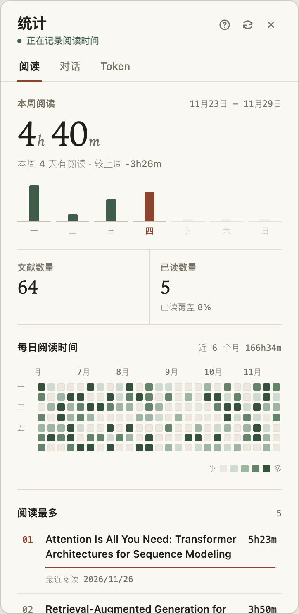
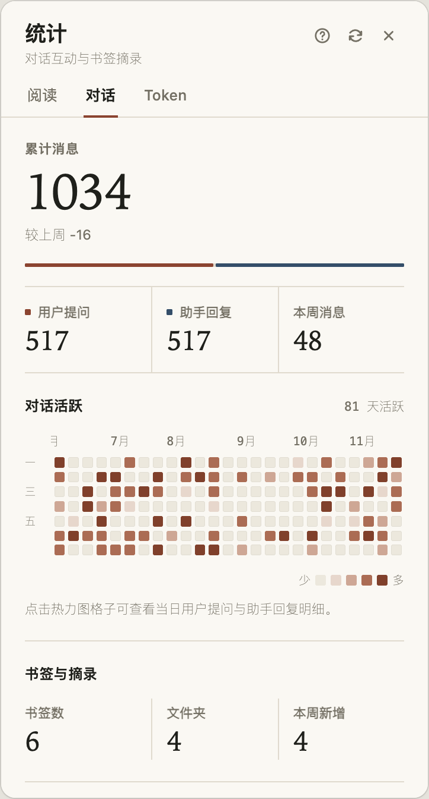
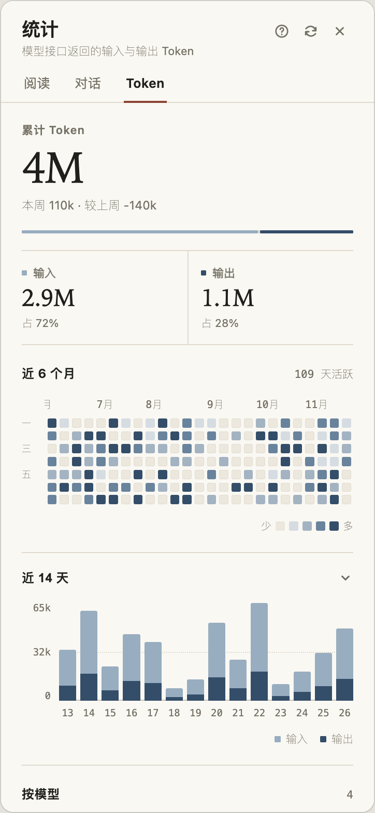
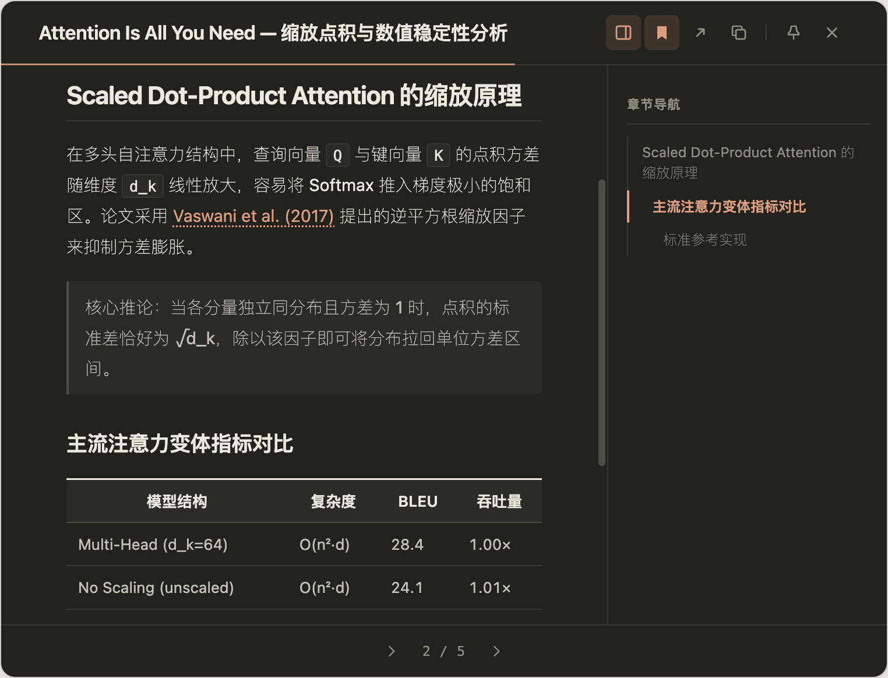
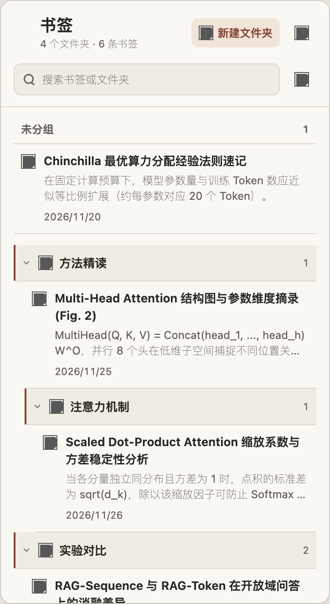
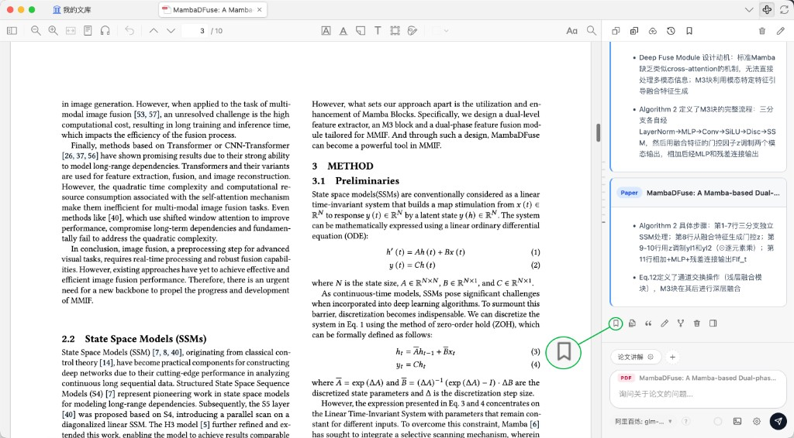
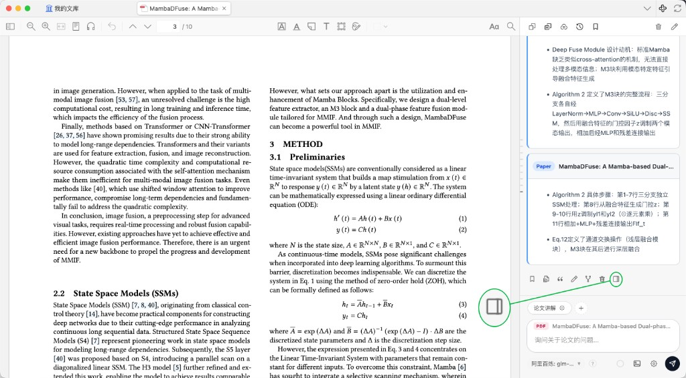
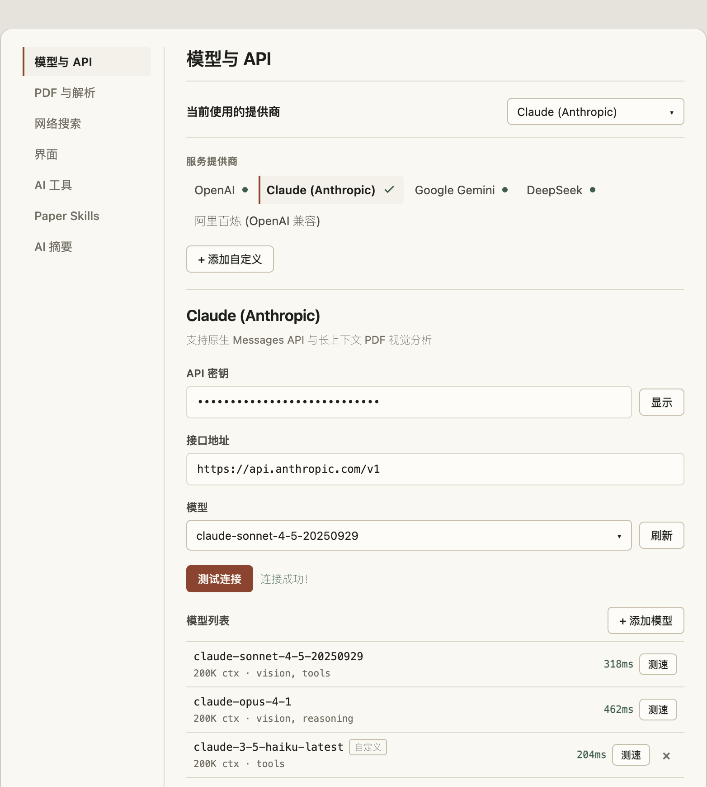
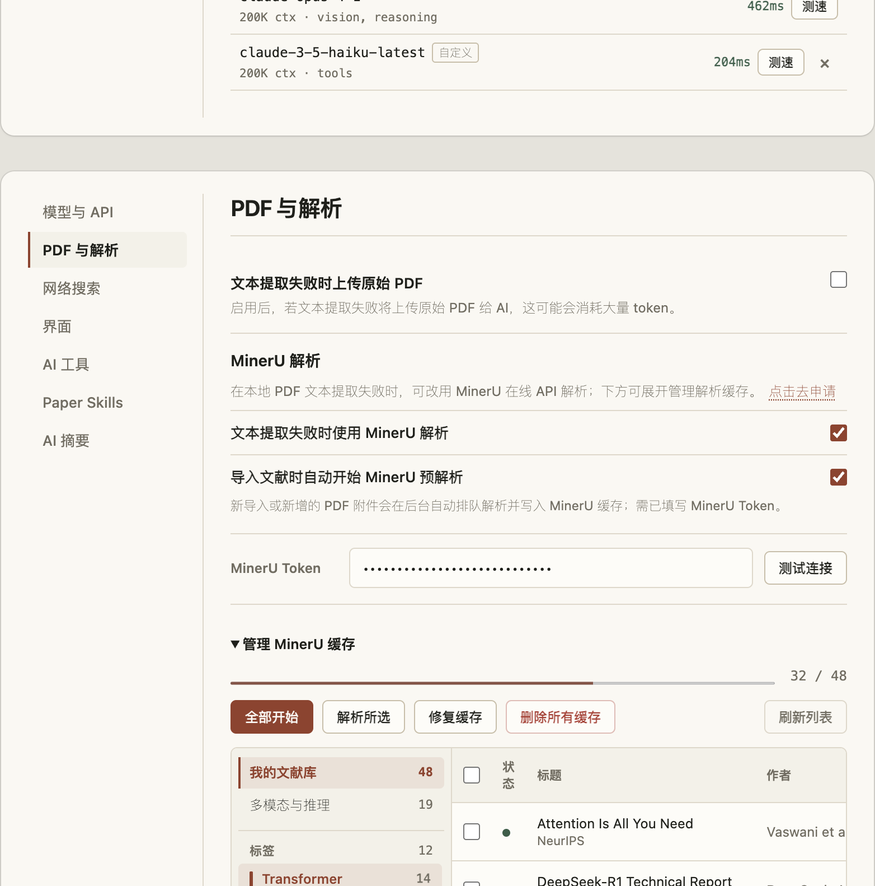

<div align="center">
  
  <h1>PaperMind · 论文智读</h1>
  <p><strong>直接运行在 Zotero 内的 AI 论文精读与科研对话助手</strong></p>
  <p>
    无需将 PDF 上传到第三方网页，在 Zotero 阅读器侧边栏或独立浮窗即可精读论文、框选图表、溯源原文公式、跨文献对比与沉淀书签笔记。
  </p>

  <p>
    <a href="https://www.zotero.org"></a>
    <a href="https://github.com/xutaoya/paper-mind/releases"></a>
    <a href="https://zotero-chinese.com/plugins/"></a>
    <a href="LICENSE"></a>
    <a href="https://github.com/syt2/paper-chat-for-zotero"></a>
    <a href="https://github.com/windingwind/zotero-plugin-template"></a>
  </p>

  <p>
    <a href="#核心特性">核心特性</a> ·
    <a href="#界面预览">界面预览</a> ·
    <a href="#安装">快速安装</a> ·
    <a href="#配置">服务商配置</a> ·
    <a href="#使用指南">使用指南</a> ·
    <a href="#本地开发">本地开发</a>
  </p>

  <br />

  
</div>

---

**PaperMind**（论文智读）是基于 [syt2/paper-chat-for-zotero](https://github.com/syt2/paper-chat-for-zotero) 持续演进的个人二创分支，使用独立的插件 ID（`paper-chat-xutao@zotero.plugin`），**可与原版并存安装**。

已上架 [Zotero 中文社区插件商店](https://zotero-chinese.com/plugins/)，国内用户可直接通过镜像下载安装。

---

## 核心特性

### 1. 沉浸式阅读与多模态对话

| 能力                         | 说明                                                                                                 |
| ---------------------------- | ---------------------------------------------------------------------------------------------------- |
| **侧边栏 / 悬浮窗双模式**    | 在 PDF 阅读器侧边栏内嵌对话，或一键切换为可置顶、自动记忆位置的独立浮窗                              |
| **图表框选与选区提问**       | 选中 PDF 文本直接向 AI 提问，或框选图表区域自动截图带入当前对话                                      |
| **上下文与 Token 透明可控**  | 输入框上方直观展示附加上下文（PDF、选区、截图、引用）；点击背景信息窗口实时查看 Token 占用与剩余比例 |
| **流式 Markdown 与公式渲染** | 原生支持 LaTeX 数学公式、代码高亮、学术三线表；输出因长度截断时支持自动续写                          |
| **顺手的对话管理**           | 支持多会话切换、历史全文搜索、轮次快速导航、编辑重发、换模型重试、消息排队与「猜你想问」提示         |

### 2. 跨文献研究与证据溯源

| 能力                       | 说明                                                                                      |
| -------------------------- | ----------------------------------------------------------------------------------------- |
| **全库 / 分类 / 多篇对比** | 不止于单篇 PDF——可面向整个文库、指定分类或勾选的多篇论文发起检索与横向对比                |
| **证据引用与原页公式预览** | 回答支持附带证据角标，点击可在弹窗中直接预览对应 PDF 原页及编号公式，并一键跳转至原文位置 |
| **学术联网检索**           | 内置学术搜索路由（OpenAlex、Google Scholar、Europe PMC 等），并支持按需配置 Exa 检索      |
| **MinerU PDF 深度解析**    | 遇到扫描件、复杂多栏或公式提取失败的 PDF 时，支持自动/手动调用 MinerU 解析并本地缓存      |

### 3. 知识沉淀：书签、精读阅读器与笔记

| 能力                       | 说明                                                                                             |
| -------------------------- | ------------------------------------------------------------------------------------------------ |
| **多级书签与拖拽整理**     | 一键收藏精彩 AI 回复或 PDF 摘录，支持嵌套文件夹、手动拖拽排序、关键词检索与 JSON 导入导出        |
| **独立典籍精读阅读器**     | 专为长回答打造的阅读窗口，具备章节导航大纲、阅读进度条、上下条翻页；原消息删除后仍保留已归档副本 |
| **一键整理为 Zotero 笔记** | 将单条回复或整段对话整理为结构化 Zotero 笔记（支持保留 LaTeX 公式），可选独立笔记或条目子笔记    |

### 4. 数据洞察与灵活配置

| 能力                   | 说明                                                                                                                                                    |
| ---------------------- | ------------------------------------------------------------------------------------------------------------------------------------------------------- |
| **三视图统计面板**     | 涵盖 **阅读**（近 6 个月阅读热力图、本周时长与连续天数、单篇阅读排行）、**对话**（活跃热力图、书签概览）与 **Token**（近 6 个月/14 天用量与按模型明细） |
| **多服务商与模型测速** | 自备 API Key，内置 OpenAI、Claude、Gemini、DeepSeek，支持任意 OpenAI 兼容接口（如阿里百炼等）与内置 API 延迟测速                                        |
| **自定义快捷操作**     | 底部快捷按钮可一键触发常用 Prompt（论文讲解、文献标注、标签生成等），支持增删改与拖拽排序                                                               |

> [!NOTE]
> **与上游分支的差异**
>
> - **本分支重点增强**：书签与独立精读阅读器、阅读/对话/Token 三视图统计、PDF 证据与编号公式原页预览、输出截断自动续写、笔记 LaTeX 公式保留、模型 API 测速，以及面向长文与侧边栏重新打磨的界面视觉。
> - **刻意未跟进项**：演示文稿（PPT）生成、内置 PaperChat 托管服务——如需这些功能，请使用 [上游原版](https://github.com/syt2/paper-chat-for-zotero)。

---

## 界面预览

### 阅读、对话与 Token 三视图统计

<table>
  <tr>
    <td align="center" width="33%">
      <br />
      <sub>阅读时长 · 热力图与文献排行</sub>
    </td>
    <td align="center" width="33%">
      <br />
      <sub>对话活跃 · 书签与摘录概览</sub>
    </td>
    <td align="center" width="33%">
      <br />
      <sub>Token 用量 · 14 日趋势与按模型统计</sub>
    </td>
  </tr>
</table>

### 书签管理与独立精读阅读器

<table>
  <tr>
    <td align="center" width="50%">
      <br />
      <sub>独立精读阅读器（浅色 · 三线表与代码块）</sub>
    </td>
    <td align="center" width="50%">
      <br />
      <sub>章节导航大纲（深色模式）</sub>
    </td>
  </tr>
  <tr>
    <td align="center" colspan="2">
      <br />
      <sub>书签管理 · 嵌套文件夹、拖拽排序与检索</sub>
    </td>
  </tr>
</table>

<details>
<summary><strong>展开查看：Zotero 阅读器内交互示意（早期版本实机截图，6 张）</strong></summary>
<br />

<table>
  <tr>
    <td align="center" width="50%">
      <br />
      <sub>阅读器分屏对话</sub>
    </td>
    <td align="center" width="50%">
      <br />
      <sub>对话面板与快捷操作</sub>
    </td>
  </tr>
  <tr>
    <td align="center">
      <br />
      <sub>框选图表截图提问</sub>
    </td>
    <td align="center">
      <br />
      <sub>背景信息窗口与 Token 占用</sub>
    </td>
  </tr>
  <tr>
    <td align="center">
      <br />
      <sub>从对话消息保存书签</sub>
    </td>
    <td align="center">
      <br />
      <sub>从阅读器保存书签</sub>
    </td>
  </tr>
</table>

</details>

---

## 安装

> [!TIP]
> **版本要求**：适配 **Zotero 8+**（`manifest.json` 要求 `7.999` – `10.0.*`）。插件 ID 与上游不同，已安装原版的用户可直接共存安装，互不冲突。

### 方式一：Zotero 中文社区插件商店（推荐）

1. 打开 [Zotero 中文社区插件商店](https://zotero-chinese.com/plugins/)
2. 搜索 **PaperMind**（论文智读），下载最新 `.xpi` 安装包
3. 在 Zotero 中依次打开 `工具` → `附加组件` → 右上角 ⚙️ → **从文件安装附加组件**，选择 `.xpi`
4. 重启 Zotero 完成安装

### 方式二：GitHub Releases

前往 [GitHub Releases](https://github.com/xutaoya/paper-mind/releases) 下载最新版本的 `.xpi`，按上述步骤 3–4 安装即可。

生产构建版本会在启动时自动检查更新。

---

## 配置

打开 Zotero `设置` → **PaperMind**：

1. **选择服务商**：内置 OpenAI、Claude、Gemini、DeepSeek，也可添加任意 OpenAI 兼容服务商（如阿里百炼、硅基流动、本地代理等）
2. **填写凭据与模型**：填入 **API Key** 与 **接口地址**，拉取或添加所需 **模型**
3. **验证与测速**：点击 **测试连接** 确认可用，必要时使用模型测速对比响应速度
4. **按需开启扩展能力**（可选）：在设置中配置 **MinerU** Token 以增强复杂 PDF 解析，或配置 **Exa** 增强学术联网检索

<table>
  <tr>
    <td align="center" width="50%">
      <br />
      <sub>服务商与模型配置</sub>
    </td>
    <td align="center" width="50%">
      <br />
      <sub>MinerU PDF 解析配置</sub>
    </td>
  </tr>
</table>

---

## 使用指南

### 单篇精读与图表提问

1. 在 Zotero 中打开任意 PDF，点击阅读器右侧工具栏的聊天图标打开侧边栏（也可切换为悬浮窗模式）
2. 直接提问，或勾选 **附加 PDF** 提供全文上下文；随时点击 **背景信息窗口** 查看当前 Token 占用
3. 选中段落点击 **向 AI 提问**，或点击截图工具 **框选图表区域** 自动带入对话
4. 使用底部 **快捷操作** 一键触发常用分析模板（论文讲解、文献标注、标签生成等）

### 跨文献与全库对话

- 在文库主界面打开聊天面板即可针对 **整个文库** 发起检索与问答
- 右键点击某个分类选择 **就此分类开始 AI 对话**，或选中多篇文献选择 **在 AI 对话中比较选中论文**，快速进行多篇对比与综述整理

### 书签沉淀与笔记导出

- 点击任意回答或阅读器中的 **书签** 图标保存重要内容，通过书签面板分文件夹管理、拖拽排序、全文检索，并在独立精读阅读器中带章节导航回看
- 点击回复或会话操作中的 **添加到条目笔记 / 整理为笔记**，将讨论结论（含 LaTeX 公式）沉淀回 Zotero 笔记

### 阅读与用量复盘

- 打开聊天面板顶部的 **统计** 按钮，即可在 **阅读 / 对话 / Token** 三个视图间切换，查看近 6 个月阅读热力图、文献阅读排行、对话活跃度与按模型统计的 Token 消耗

---

## 本地开发

```bash
npm install
npm run build        # 构建插件，产物位于 .scaffold/build/
npm start            # 启动本地开发调试
```

提交前建议运行完整校验：

```bash
npm run typecheck                     # TypeScript 类型检查
npm run lint:check                    # 全仓 Prettier 格式与 ESLint 检查
npm run test:unit                     # Node 单元测试
npm run test:online-release-upgrade   # 隔离 Zotero 验证历史数据升级与幂等性
npm run test -- --no-watch            # 隔离 Zotero 验证插件启动与集成行为
```

> Zotero 集成测试需提前配置环境变量 `ZOTERO_PLUGIN_ZOTERO_BIN_PATH`，测试运行仅使用 `.scaffold/test/` 下的隔离配置与数据目录，不会影响本地正式文库。

发布新版本：

```bash
npm run release
```

执行后会自动构建生产包、创建 GitHub Release（标签格式 `V版本号`），并更新 `release` 标签下的 `update.json`。

---

## 许可证与致谢

本项目采用 [AGPL-3.0](LICENSE) 许可证（继承自上游项目）。

- 上游原作者：[syt2/paper-chat-for-zotero](https://github.com/syt2/paper-chat-for-zotero)
- 插件脚手架：[windingwind/zotero-plugin-template](https://github.com/windingwind/zotero-plugin-template)
- 中文分发渠道：[Zotero 中文社区](https://zotero-chinese.com)
